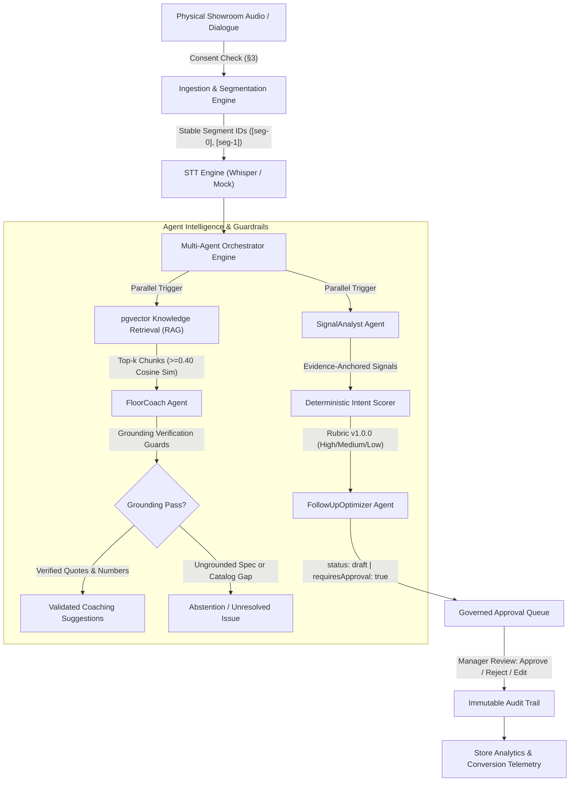

# StoreSignal AI
### Agentic Retail Intelligence & Conversion Platform

[](https://www.typescriptlang.org/)
[](https://fastify.dev/)
[](https://react.dev/)
[](https://github.com/pgvector/pgvector)
[](LICENSE)

> **StoreSignal AI** bridges the physical retail showroom and the digital conversion funnel. It captures, transcribes, and understands physical conversations between sales advisors and prospective buyers, grounds all technical product claims in verified documentation, computes deterministic commercial intent, and equips store managers with governed, human-approved follow-up drafts.

---

## 1. Problem Statement

In physical automotive and luxury retail, the in-store floor conversation is the single highest-value interaction in the customer journey—yet it is completely invisible to digital systems:

1. **Conversations Vanish into Thin Air:** When a customer walks out of the showroom, their specific questions, objections, and lifestyle context are lost unless the advisor manually logs notes into a CRM hours later.
2. **Technical Misquotes & Spec Hallucinations:** Showroom advisors under pressure frequently misquote complex technical specifications (e.g., real-world EV battery range, fast-charging curves, torque figures, or warranty limitations), risking consumer disputes.
3. **Manager Blindspots:** Dealership managers have zero visibility into recurring customer objections or advisor coaching opportunities until monthly sales numbers drop.
4. **Generic, Context-Free Follow-Ups:** Post-visit outreach defaults to spammy generic templates ("Thanks for visiting!") that ignore what the customer actually cared about.

**StoreSignal AI solves this end-to-end** with privacy-first conversation ingestion, retrieval-augmented grounding guards, deterministic commercial scoring, and human-in-the-loop follow-up drafts.

---

## 2. System Architecture



For full architecture details, entity-relationship diagrams, lifecycle state machines, and trust boundaries, see [docs/architecture.md](docs/architecture.md).

---

## 3. Quick Start (<= 5 Commands)

Get the complete platform running locally with seeded vehicle retail data in under 2 minutes:

```bash
# 1. Clone the repository
git clone https://github.com/your-org/storesignal-ai.git && cd storesignal-ai

# 2. Configure environment
cp .env.example .env

# 3. Install monorepo dependencies
npm install

# 4. Spin up PostgreSQL with pgvector and seed showroom demo data
docker compose up -d postgres && npm run demo:seed

# 5. Launch both API (:3001) and Web UI (:5173) in development mode
npm run dev
```

- **Web Dashboard:** Open [http://localhost:5173](http://localhost:5173)
- **API Health Check:** `curl http://localhost:3001/health`

---

## 4. Guided Demonstration Tour

Follow the step-by-step [docs/demo-script.md](docs/demo-script.md) (3–5 minutes) to evaluate the core platform capabilities:

1. **Retail Analytics & Telemetry (Phase 11):** Inspect live aggregated metrics across 2 multi-tenant stores (Indiranagar and Koramangala)—intent distribution, conversion rates, and evidence-linked objection quotes.
2. **Live Dialogue & Multi-Agent Studio (Phases 3–9):** Ingest physical dialogues with mandatory customer consent checks, observe speaker normalization, and trigger parallel agent execution with execution traces.
3. **Deliberate Knowledge Gap Handling (Phase 6):** Submit an inquiry for uncataloged specs (e.g., 250cc tourer or aftermarket CNG kit) and verify that FloorCoach cleanly **abstains** without hallucinating figures.
4. **Governed Follow-Up Queue (Phase 8):** Review personalized WhatsApp follow-up drafts. Verify that zero drafts can be dispatched without explicit store manager approval.
5. **Unified Shopper Profile & Continuity (Phase 10):** Observe cross-visit memory linking repeat shoppers and granting a +8 rubric intent bonus.
6. **Campaign Experimentation & Simulator (Phase 13):** Run deterministic SHA-256 variant bucketing and statistical significance testing (Wilson score intervals and two-proportion z-tests).

---

## 5. Technical Decisions & Rationale

| Architecture Decision | Choice | Rationale |
|---|---|---|
| **Monorepo Architecture** | npm workspaces + Fastify + Vite React | Unified TypeScript types across backend and frontend with zero build-tool bloat. Fastify 5 delivers sub-millisecond route latency and robust schema validation. |
| **Vector Storage** | PostgreSQL 16 + `pgvector` | Eliminates disparate vector database infrastructure. Enables single-transaction ACID consistency across relational entities, transcripts, and embeddings. |
| **LLM Gateway & Errors** | OpenRouter API + strict §7.5 taxonomy | Centralized client with automatic fallback model retries, explicit error classification (`AUTHENTICATION_ERROR`, `RATE_LIMIT_EXCEEDED`, `MODEL_UNAVAILABLE`), and zero credential leakage. |
| **Grounding Enforcement** | Post-generation code guards | Prompts alone cannot guarantee zero hallucinations. Code-level guards verify quote containment, source chunk ID subsets, and numeric token grounding. |
| **Intent Scoring** | Deterministic code rubric (v1.0.0) | Intent classification is separated from LLM extraction. The LLM extracts verified signals; deterministic code applies weighted rubrics, volume caps, and shopper continuity weights. |
| **Follow-Up Governance** | Human approval mandatory | Zero automated dispatch clients exist in the codebase. All drafts require explicit human review, generating an immutable audit trail. |
| **Password Security** | Native Node.js `scrypt` | OWASP-grade memory-hard protection against GPU/ASIC attacks without brittle binary compilation dependencies (`node-gyp`). Uses constant-time equality comparisons. |

For deep architectural analyses, review the 15 Architectural Decision Records in [docs/adr/](docs/adr/).

---

## 6. What's Real vs. Demo

To maintain complete engineering honesty and transparency:

### Production-Grade & Live in Code
- **Database Engine & Schemas:** 8 migration scripts covering multi-tenancy, vector indexes, conversation segments, shopper profiles, drafts, and RBAC.
- **Deterministic Intent Scorer:** Fully implemented mathematical rubric engine with volume caps, explicit-basis guards, and cross-visit weights.
- **Grounding Guards:** Active algorithmic post-processors verifying verbatim quote containment, source subset matching, and numeric token validation.
- **Multi-Agent State Machine:** Real distributed conversation locking, partial failure semantics, and lifecycle state management (`apps/api/src/orchestration/`).
- **Authentication & RBAC:** Native scrypt password hashing, constant-time verification, rotating refresh tokens, and role-based endpoint gating.
- **Right to Erasure (GDPR / India DPDP Act 2023):** Real database cascade deleting audio references, transcripts, embeddings, and profiles while generating zero-PII audit hashes.
- **AI Evaluation Harness:** 22-case golden benchmark suite with 100% pass rates across intent accuracy, fact grounding, gap abstention, consent enforcement, and approval gating.

### Demonstration & Mock Adapters
- **Embeddings Provider:** Uses a deterministic token hash vector projector (`MockEmbeddingProvider`) for reproducible offline test execution without third-party API dependencies. (Can be swapped with OpenAI `text-embedding-3-small` in one config line).
- **Speech-to-Text:** Includes `WhisperSTTProvider` for live OpenAI Whisper transcription and `MockSTTProvider` for hermetic test execution.
- **Outcome Ingestion Simulator:** The experimentation dashboard includes an in-browser deterministic simulation runner to illustrate conversion significance testing without waiting for multi-week showroom foot traffic.

---

## 7. Limitations & Honest Failure Analysis

Based on the 22-case AI evaluation harness ([reports/eval_report.md](reports/eval_report.md)):

1. **Strict Numeric Grounding Trade-Off:** The FloorCoach grounding guard will reject any suggestion containing a number not present in the RAG chunks. While this completely eliminates hallucinated specs, it means custom, ad-hoc advisor discounts (e.g., "I can take ₹5,000 off today") are flagged as ungrounded unless officially cataloged.
2. **Acoustic Overlap in Busy Showrooms:** High ambient noise and multi-party overlapping speech require physical directional mic arrays or lapel microphones. Single omnidirectional boundary microphones struggle with simultaneous speaker diarization.
3. **Hinglish / Code-Mixed Nuance:** Sales conversations in metropolitan Indian showrooms regularly mix Hindi, Kannada, Tamil, and English. Whisper handles code-mixing reasonably well, but colloquial regional slang requires continuous prompt contextualization.

---

## 8. Verification & Test Evidence

Run the complete verification battery:

```bash
# Run all 114 unit and integration tests across 21 test suites
npm test

# Run strict TypeScript typechecking across all workspaces
npm run typecheck --workspaces

# Run the 22-case AI Evaluation Harness
npm run eval

# Verify production builds
npm run build --workspaces
```

**Test Suite Coverage Summary:**
- `ai-routes.test.ts` (14 tests) — OpenRouter integration and error taxonomy.
- `auth-rbac.test.ts` (7 tests) — Scrypt hashing, token rotation, and RBAC guards.
- `conversations.test.ts` (8 tests) — Ingestion, segmentation, and consent checks.
- `stt.test.ts` (5 tests) — STT providers, versioned edits, and erasure cascade.
- `rag.test.ts` (7 tests) — Structure-aware chunking and pgvector retrieval.
- `floor-coach.test.ts` (6 tests) — Grounding guards, quote containment, and gap abstention.
- `signal-analyst.test.ts` (7 tests) — Evidence extraction and deterministic intent rubric.
- `followup.test.ts` (6 tests) — Draft governance, score leakage, and approval state machine.
- `orchestrator.test.ts` (7 tests) — Multi-agent engine, locking, and failure resilience.
- `shopper-profile.test.ts` (7 tests) — Permitted identifiers, cross-visit memory, and erasure.
- `analytics.test.ts` (6 tests) — Areas A–F aggregation and RFC 4180 CSV export.
- `eval-harness.test.ts` (5 tests) — Golden dataset evaluation gates.
- `experiments.test.ts` (11 tests) — SHA-256 bucketing, Wilson intervals, and z-tests.

---

## 9. Future Roadmap

- **Streaming WebSocket STT:** Real-time low-latency transcription stream for live earbud whispering during active sales negotiations.
- **Enterprise Messaging Adapters:** Outbound integration plugins for WhatsApp Business Cloud API, Gupshup, and SendGrid (once approved by store manager).
- **Bidirectional CRM / POS Sync:** Real-time webhooks for Salesforce Automotive Cloud, HubSpot, and SAP Customer Experience.
- **Contextual Multi-Armed Bandits:** Thompson Sampling bandit models for dynamic variant allocation based on customer persona and intent score.

---

## 10. License

This project is licensed under the [MIT License](LICENSE).
