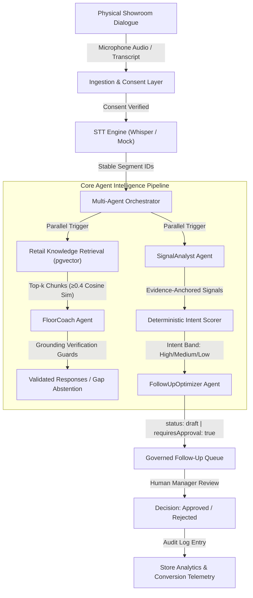
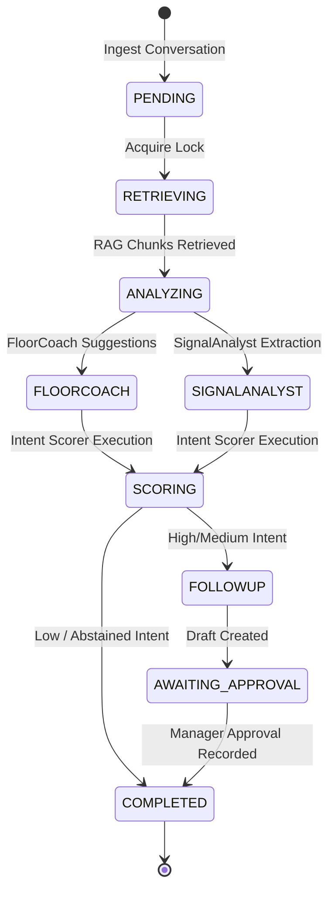
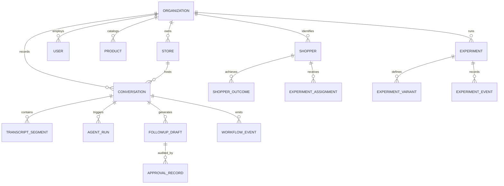

# StoreSignal AI — System Architecture Specification

## 1. System Overview & Topology

StoreSignal AI bridges the physical showroom and the digital conversion funnel. It captures, transcribes, and understands physical conversations between automobile sales advisors and prospective buyers, grounds all technical claims in verified manufacturer manuals, computes deterministic commercial intent, and equips store managers with governed, editable follow-up drafts.

---

## 2. Multi-Agent Orchestration & Lifecycle State Machine

The platform executes pipeline agents with partial failure resilience, distributed conversation locking, and strict execution state transitions:

---

## 3. Data Model & Entity Relationships

---

## 4. Deterministic Intent Scoring Rubric (v1.0.0)

To eliminate probabilistic LLM hallucinations in commercial scoring, extraction is separated from scoring:
1. **LLM Role (SignalAnalyst):** Extracts signals strictly bounded by verbatim transcript quotes:
   - `requested_trial_or_test_ride` (+25 pts)
   - `stated_timeline_immediate` (+20 pts)
   - `asked_pricing_or_discounts` (+15 pts)
   - `asked_financing` (+15 pts)
   - `positive_test_ride_feedback` (+10 pts)
   - `stated_browsing_only` (-20 pts)
   - `price_sensitivity` (-10 pts)
   - `returning_shopper_bonus` (+8 pts via ShopperProfileService)
2. **Deterministic Code Role (IntentScorer):**
   - Accumulates weights against `baseScore = 20`.
   - Clamps score strictly within $[0, 100]$.
   - Bins:
     - `high`: Score $\ge 70$
     - `medium`: $40 \le \text{Score} < 70$
     - `low`: $\text{Score} < 40$
   - **Abstention Guard (§6.2):** If customer segments $< 2$, customer words $< 10$, or zero valid signals are found, the scorer abstains (`score: null, band: null`).

---

## 5. Trust Boundaries & Security Enclaves

| Boundary | Inbound Trust | Enforced Control |
|---|---|---|
| **Client Browser $\rightarrow$ API** | Untrusted public network | Strict CORS (APP_URL only), Helmet security headers, rate-limiting, scrypt auth |
| **Spoken Dialogue $\rightarrow$ Pipeline** | Untrusted speech | Speaker diarization, PII redaction, prompt injection boundaries, consent verification |
| **Agent Prompt $\rightarrow$ Output** | Non-deterministic AI | Zod output schemas, source subset verification, numeric spec grounding guards |
| **Draft $\rightarrow$ Outbound Customer** | Governed air gap | **Zero automated send path**. Manual human manager approval mandatory |
| **Tenant Org A $\rightarrow$ Tenant Org B** | Untrusted multi-tenant | Fastify preHandler context isolation, DB `org_id` WHERE clauses, 404 access denial |
